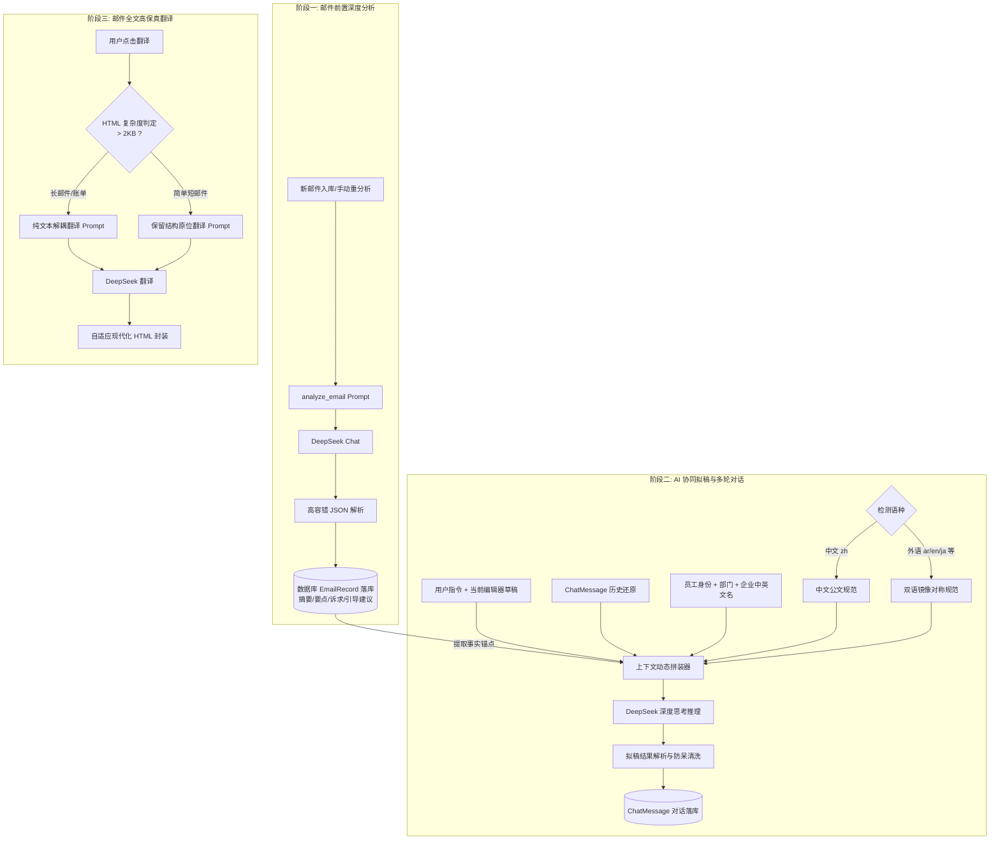

# 邮件助手 Agent 上下文与 Prompt 工程规范

本文档为“知了 · AI 企业邮件工作台”系统内所有大模型（LLM）调用链、上下文装配（Context Assembly）、提示词（Prompt）设计与多轮人机协同拟稿机制的统一技术规范与维护指南。

---

## 目录

1. [上下文工程体系全景架构](#1-上下文工程体系全景架构)
2. [阶段一：邮件前置深度分析（analyze_email）](#2-阶段一邮件前置深度分析analyze_email)
3. [阶段二：AI 协同拟稿与多轮对话（chat_and_refine_reply）](#3-阶段二ai-协同拟稿与多轮对话chat_and_refine_reply)
4. [阶段三：邮件全文高保真翻译（translate_email）](#4-阶段三邮件全文高保真翻译translate_email)
5. [底层保障：高容错 JSON 提取与清洗引擎](#5-底层保障高容错-json-提取与清洗引擎)
6. [端到端典型实战用例（以阿拉伯语邮件为例）](#6-端到端典型实战用例以阿拉伯语邮件为例)
7. [后续维护与二次开发红线清单](#7-后续维护与二次开发红线清单)

---

## 1. 上下文工程体系全景架构

系统内邮件处理与大模型交互采用**“分阶段解耦、渐进式沉淀事实锚点”**的流水线设计：



### 核心设计原则

1. **事实锚点机制（Anti-Drift）**：邮件的核心事实（摘要、关键参数、客户诉求）在阶段一提取并持久化至数据库，在阶段二作为只读不可篡改的锚点注入 Prompt，彻底杜绝多轮对话后模型产生的“幻觉偏航”。
2. **定稿保护机制（Draft Preservation）**：通过在 Prompt 中注入当前编辑器草稿与历史草稿的比对指引（Context Diff），模型能够智能识别员工手动修改了中文还是外文，严格锁死员工已确认的语言版本。
3. **按需出稿原则（Communication First）**：Agent 兼具“战略顾问”与“专业文书”双重角色。在探讨策略、咨询意图时只输出思考沟通内容，不擅自覆写员工编辑器草稿。
4. **绝对身份红线（Anti-Signature-Inversion）**：邮件落款强制绑定我方员工与我方企业名称，严防将原信发件人错签为回信人的逻辑倒置。

---

## 2. 阶段一：邮件前置深度分析（`analyze_email`）

- **实现位置**：`backend/app/services/ai_service.py` -> `AIService.analyze_email`
- **触发入口**：
  - 后台轮询收信：`backend/app/services/scheduler.py`
  - 邮件手动重分析：`backend/app/api/emails.py` (`POST /api/emails/{id}/reanalyze`)

### 2.1 Prompt 结构与核心约束

```markdown
# System Prompt
你是一位精通跨国商务、外贸外语与企业沟通的高级智能邮件助理。
你的任务是深入阅读客户/发件人的来信，并为中国团队员工完成结构化分析与中文化梳理，给出切实可行的应对建议。
注意：此时请不要起草完整回信草稿，邮件草稿将在员工给出明确指令后再行撰写。

请严格输出 JSON 格式（不要包含任何 markdown 代码块标记如 ```json），格式如下：
{
  "language_detected": "源邮件语言代码，如 en, ja, de, zh 等",
  "summary_zh": "极简中文核心摘要，严格控制在15~20字以内！直奔主题，严禁使用任何'这是一封来自...'、'系统通知告知...'等无意义废话套话。直接说明最核心的事由动作...",
  "key_points": [
    "要点1：用通俗中文说明来信的核心背景与主要事实内容（邮件具体在说什么）",
    "要点2：商务条款、技术参数、时间节点或具体细节"
  ],
  "action_items": [
    "对方明确提出的要求、问题或我方需要处理的待办事项"
  ],
  "guided_question": "AI专业应对建议：从专业商务沟通、谈判博弈或业务协同角度，为员工提出具体可行的应对思路与建议..."
}

# User Content
邮件主题: {subject}
发件人: {sender}

邮件原文内容:
{trimmed_body}
```

### 2.2 关键控制参数与防爆机制

- **输入截断**：`body_text[:4000]`，防止超长邮件（如包含万行日志或 BASE64 垃圾字符）撑爆上下文窗口。
- **Temperature**：`0.3`（低随机性，确保事实提炼的高度精准与客观）。
- **Reasoning Effort / Thinking Type**：`disabled`（阶段一追求分析吞吐与响应速度，通常 2~3 秒内完成入库）。

---

## 3. 阶段二：AI 协同拟稿与多轮对话（`chat_and_refine_reply`）

- **实现位置**：`backend/app/services/ai_service.py` -> `AIService.chat_and_refine_reply`
- **API 调用链路**：`backend/app/api/ai_chat.py` -> `POST /api/chat/{email_id}`

### 3.1 上下文拼接流水线

上下文由 System Prompt、多轮对话历史（Messages History）和当前用户轮次（User Turn）三部分组装而成：

#### 模块 A：身份信息与防倒置红线

```text
【沟通双方身份信息（非常重要，严禁混淆！）】：
- 【对方客户（收件人 / 原信发件方）】：{sender}
- 【我方回信人（发件方 / 我方员工）】：{user_display}
- 【我方所在部门】：{dept_display}
- 【我方企业名称】：中文：{company_name}，英文/国际通用：{company_name_en}
- 邮件主题：{subject}
- 邮件判定语言：{language_detected}
- 邮件原文摘录：{original_body[:2500]}
```

**绝对红线规则**：

1. 回信落款发信人必须是我方员工姓名及公司名。
2. 严禁将客户发件人姓名署名在回信末尾。

#### 模块 B：前置事实锚点注入

将阶段一持久化在数据库中的结构化分析作为事实底座注入：

```text
【原邮件核心事实与 AI 前置深度分析锚点（牢记客户诉求，杜绝偏航）】：
- 【邮件核心中文摘要】：{ai_summary}
- 【核心事实与要点】：{key_points}
- 【对方核心诉求与待办事项】：{action_items}
```

#### 模块 C：动态语言分支（Language Rules）

- **中文邮件（`zh`）**：
  - 使用地道规范的简体中文商业信函格式。
  - `draft_reply_zh` 为空，草稿直接写入 `draft_reply`。
- **外语邮件（`ar` 阿拉伯语、`en` 英语、`ja` 日语、`de` 德语等）**：
  - `draft_reply`：必须是地道、纯净的外语信件（严禁包含任何中文翻译或注释）。
  - `draft_reply_zh`：必须提供与外语草稿 **1:1 逐段镜像对称** 的完整正式中文公文（包含尊称、逐段译文、祝颂语、我方署名落款）。
  - `explanation`：逐条说明外文邮件表达的要点与采取的商务沟通策略。

#### 模块 D：排版规范与双换行符（`\n\n`）铁律

- 商业邮件必须具有良好的视觉呼吸感。
- 强制收件人称谓后空一行、各正文段落之间空一行、正文与祝颂语空一行、祝颂语与落款空一行。
- 即使员工手写参考文本中缺少空行（如紧凑单换行），模型也必须自动识别语义分段并补齐 `\n\n`。

#### 模块 E：定稿保护与上下文 Diff 研判

指导模型研判多轮修改意图：

- **情形 A（员工修改了中文）**：100% 完整保留员工修改后的中文公文，禁止擅自改写；以此为黄金基准，精准重新翻译外文原稿。
- **情形 B（员工修改了外文）**：100% 完整保留员工修改后的外文，以此为准校准 1:1 中文公文。
- **情形 C（双语均修改）**：综合理解核心诉求，有机协调双语。
- **情形 D（局部增补）**：在已有定稿基础上就地插入新要素，严禁推倒重来。

#### 模块 F：多轮历史记忆反碎片化还原（`ai_chat.py`）

在 API 层遍历历史消息时，对 Assistant 的输出进行结构化重构：

```python
# 遍历历史记录，将上一轮助手输出的草稿、对照与策略完整还原为消息内容
if m.role == "assistant":
    parts = []
    if m.content:
        parts.append(m.content)
    if m.draft_reply:
        parts.append(f"【外语回复草稿】:\n{m.draft_reply}")
    if getattr(m, "draft_reply_zh", ""):
        parts.append(f"【完整中文公文对照】:\n{m.draft_reply_zh}")
    if getattr(m, "explanation", ""):
        parts.append(f"【策略与要点说明】:\n{m.explanation}")
    chat_history.append({
        "role": "assistant",
        "content": "\n\n".join(parts) if parts else (m.content or "")
    })
```

#### 模块 G：当前用户轮次组装

```text
【员工当前编辑器/界面中最新的草稿内容（请与上文历史草稿进行 Diff 比对，自主研判员工修改了中文还是外文，严格遵循定稿保护与按需出稿铁律）】：
"""
{current_draft}
"""

【员工本次的输入内容/指令】：
{user_instruction}
```

---

## 4. 阶段三：邮件全文高保真翻译（`translate_email`）

- **实现位置**：`backend/app/services/ai_service.py` -> `AIService.translate_email`
- **触发入口**：`backend/app/api/emails.py` (`POST /api/emails/{id}/translate`)

### 4.1 长短邮件解耦设计（Decoupled Strategy）

为防止长邮件或企业账单中数万字符的 HTML 导致大模型输出 JSON 时转义失败、字符截断或超出 Token 上限，系统设计了自适应解耦策略：

| 邮件类型                     | 判定条件                    | 处理策略                                                                                                                                       |
| :--------------------------- | :-------------------------- | :--------------------------------------------------------------------------------------------------------------------------------------------- |
| **短邮件**             | `clean_html <= 2000` 字节 | 原位保留 HTML 基础标签排版，模型同时输出`translated_subject`, `translated_body_html`, `translated_body_text`。                           |
| **长邮件/对账单/发票** | `clean_html > 2000` 字节  | **解耦降级处理**：Prompt 仅传入纯文本正文进行翻译，大模型仅需返回 `translated_subject` 与 `translated_body_text`，彻底杜绝转义崩溃。 |

### 4.2 现代自适应邮件 HTML 包装器

对于长邮件翻译生成的纯文本，由后端 `_wrap_text_as_clean_html` 统一包装为符合现代审美、适配移动端与暗黑背景的 HTML：

- 采用 `-apple-system, BlinkMacSystemFont, "Segoe UI", Roboto` 系统级字体。
- 自动将段落映射为带良好外边距（`margin: 0 0 14px 0`）与行高（`line-height: 1.75`）的 `<p>` 标签。

---

## 5. 底层保障：高容错 JSON 提取与清洗引擎

- **实现位置**：`backend/app/services/ai_service.py` -> `_clean_and_parse_json` 与 `_safe_parse_translation_response`

大型推理模型（如 DeepSeek-R1 / V3）在输出时常带有思维链标签、Markdown 代码块或尾部截断。清洗引擎具备五层防护网：

```mermaid
flowchart TD
    RAW[原始模型返回字符串] --> L1[第一层: 正则切除 <think>...</think> 标签]
    L1 --> L2[第二层: 直接 json.loads 尝试标准解析]
    L2 -->|失败| L3[第三层: 剥离 ```json ... ``` Markdown 代码块外壳]
    L3 -->|失败| L4[第四层: 贪婪正则匹配最外层 {...} 并自动修复尾部悬挂逗号]
    L4 -->|失败| L5[第五层: 极端降级保底]
    L5 --> RES[将文本提取至 response 字段，保证接口永不 500 崩溃]
```

---

## 6. 端到端典型实战用例（以阿拉伯语邮件为例）

以下以系统中真实接收的阿联酋客户咨询钙钛矿组件的阿拉伯语邮件（ID: 80）为例，展示其在整个生命周期中的真实上下文与处理结果：

### 6.1 原始邮件（入库态）

- **发件人**：`Ahmed Al-Mansoor <ahmed.mansoor@gulf-solar-tech.ae>`
- **主题**：`طلب استفسار بخصوص الألواح الشمسية الكهروضوئية والتعاون التجاري`
- **正文**：
  > السيد المحترم،
  > تحية طيبة وبعد،
  > نود من خلال هذه الرسالة الاستفسار عن كفاءة وأسعار خلايا البيروفسكايت الشمسية (Perovskite Solar Cells) التي تنتجها شركتكم الموقرة. نحن شركة رائدة في حلول الطاقة المتجددة في دولة الإمارات العربية المتحدة، ونهتم بشكل كبير بإمكانية استيراد منتجاتكم والتعاون معكم في مشاريع الطاقة الشمسية واسعة النطاق في منطقة الشرق الأوسط.
  > هل يمكنكم تزويدنا بالكتالوج الفني، وقوائم الأسعار للكميات الكبيرة، وكذلك شروط التسليم؟
  > مع خالص الشكر والتقدير،
  > أحمد المنصور
  >

### 6.2 阶段一分析后落库数据

- **`language_detected`**: `ar`
- **`summary_zh`**: `阿联酋客户咨询钙钛矿组件技术参数与大宗采购报价`
- **`key_points_json`**:
  ```json
  [
    "阿联酋海湾太阳能科技公司关注我司钙钛矿光伏组件（Perovskite Solar Cells）",
    "计划在中东大型地面光伏项目中评估并引入该产品",
    "索取产品规格书、大宗集装箱阶梯价格及交付贸易条款"
  ]
  ```
- **`action_items_json`**:
  ```json
  [
    "提供最新钙钛矿光伏组件技术白皮书与规格目录",
    "核算集装箱量级的大宗采购梯队报价与交期",
    "明确国际贸易交付方式（CIF 迪拜 / FOB 上海）"
  ]
  ```

### 6.3 阶段二：协同拟稿装配的完整 Prompt（典型切片）

当员工输入：*“向客户表示热烈欢迎，附上最新英文产品画册，并提议下周二下午 3 点安排 Zoom 会议深入沟通交付条款”* 时：

#### 发送给模型的 System Prompt（核心部分）

```text
你是一位精通跨国商务、企业公文与各语种沟通的高级商务邮件写作顾问。
当前正在协助【知了科技】团队员工撰写对外回复邮件。

【沟通双方身份信息（非常重要，严禁混淆！）】：
- 【对方客户（收件人 / 原信发件方）】：Ahmed Al-Mansoor <ahmed.mansoor@gulf-solar-tech.ae>
- 【我方回信人（发件方 / 我方员工）】：业务专员
- 【我方所在部门】：海外商务部
- 【我方企业名称】：中文：知了智能科技有限公司，英文/国际通用：Zhiliao Tech Co., Ltd.
- 邮件主题：طلب استفسار بخصوص الألواح الشمسية الكهروضوئية والتعاون التجاري
- 邮件判定语言：ar

【原邮件核心事实与 AI 前置深度分析锚点（牢记客户诉求，杜绝偏航）】：
- 【邮件核心中文摘要】：海外客户咨询组件技术参数与大宗采购报价
- 【核心事实与要点】：海外客户关注我司商业化产品规格...
- 【对方核心诉求与待办事项】：提供最新产品技术白皮书...

回复语言规则（最高优先级）：
【当前邮件判定为外语来信（来信语言代码：ar）】
- 必须严格使用正式得体的外语（如英文或原信语种）撰写纯净的回复邮件草稿（draft_reply），【严禁在 draft_reply 内包含任何中文说明、翻译或删除提示】！
- 必须在 draft_reply_zh 字段中提供与 draft_reply 逐段 1:1 镜像对称的完整正式简体中文商务公文...
- 必须在 explanation 字段中提供中文要点与商务策略对照说明...
```

#### 模型返回与落库结果（三位一体输出）

1. **`draft_reply`（纯净外文原稿）**：
   ```text
   Dear Mr. Ahmed Al-Mansoor,

   Thank you very much for reaching out to Zhiliao Tech and for your strong interest in our commercial technologies.

   We are pleased to attach our latest Technical Brochure and Specifications for your review. To better address your project requirements in the Middle East and discuss tier pricing along with delivery terms, we would like to propose a Zoom conference on next Tuesday at 3:00 PM (GMT+4).

   Please let us know if this schedule works for your team.

   Best regards,

   Li Hua
   Overseas Business Dept.
   Zhiliao Tech Co., Ltd.
   ```
2. **`draft_reply_zh`（1:1 镜像对称中文公文）**：
   ```text
   尊敬的艾哈迈德·阿尔曼苏尔先生：

   您好！非常感谢您联络知了科技，并对我司商业化技术方案给予高度关注。

   随信附上我们最新的《产品技术白皮书与规格目录》，供贵方审阅。为了更好地契合贵方在中东区域的地面项目需求，并就大宗采购梯队报价与交付条款展开深入沟通，我们建议于下周二下午 3:00（迪拜时间）安排一次线上视频会议。

   期待您的确认与答复。

   此致
   敬礼！

   业务专员
   海外商务部
   知了智能科技有限公司
   ```
3. **`explanation`（策略与要点说明）**：
   ```text
   1. 礼节与品牌响应：以热忱且庄重的语调对行业伙伴的垂询表示欢迎，凸显企业专业的技术能力与产业地位；
   2. 资料递送：明确在附件中交付技术规格书，直接回应客户的核心诉求；
   3. 商务推进策略：针对大宗采购阶梯报价与复杂的国际贸易交付条款，主动发起线上会议锁定沟通节点，将单向邮件问询有效推进至商务洽谈阶段。
   ```

---

## 7. 后续维护与二次开发红线清单

维护或修改 AI 上下文工程相关代码时，**必须严格遵守以下红线**：

1. **红线一：严防署名倒置**
   - 无论用户指令多简略，`draft_reply` 和 `draft_reply_zh` 末尾署名必须始终为我方员工及公司名（`Zhiliao Tech` / `知了科技`），绝不能把原信客户发件人签在落款处。
2. **红线二：定稿保护不可推翻**
   - 严禁在下一轮对话中覆盖或洗掉员工在前端编辑器中已手动调整确认的内容。只要员工确认了某语言版本，该版本即为不可更改的基准。
3. **红线三：多轮记忆必须结构化还原**
   - 修改 `ai_chat.py` 遍历历史逻辑时，必须保留 `【外语回复草稿】`、`【完整中文公文对照】`、`【策略与要点说明】` 的分块拼装，切勿只传递简略的 `content` 纯文本，否则会导致多轮对话后模型失忆。
4. **红线四：外文邮件必须三位一体（纯净外文 + 1:1 中文 + 策略说明）**
   - `draft_reply` 严禁出现中文夹杂；`draft_reply_zh` 严禁简写为“大意说明”，必须是具备完整公文格式的正式信件。
5. **红线五：排版双换行符（`\n\n`）**
   - 任何改动不得破坏正文段落之间、称呼后、落款前的双换行分隔约定，杜绝一行紧贴一行的排版恶习。
6. **红线六：长邮件翻译必须解耦**
   - 禁止盲目将大于 2KB 的复杂富文本 HTML 原文整段塞给 LLM 请求 JSON 翻译；长邮件必须通过文本清洗提取后再进行翻译包装。
