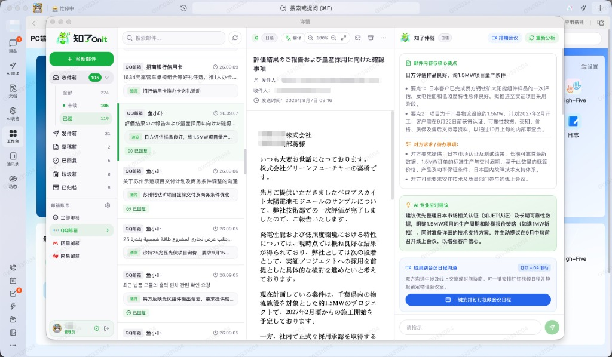
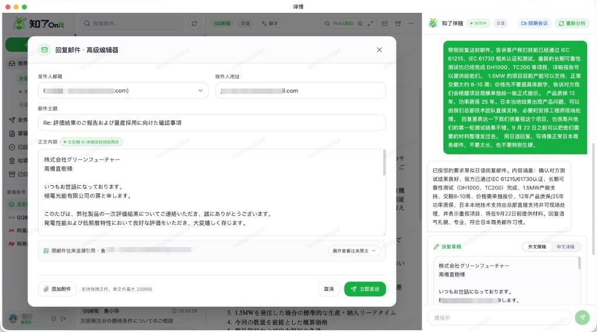
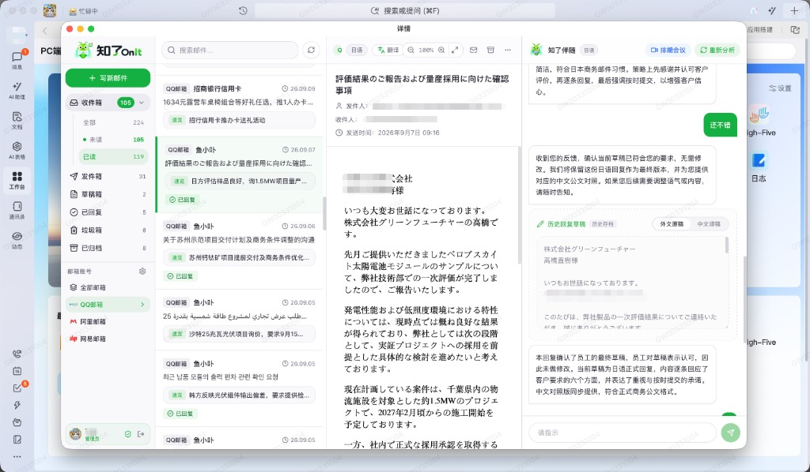

<div align="center">


# 知了 OnIt · AI 智能邮件协同工作台
### 工作的事情，就该交给工作的软件来干

<p>
  <b>别再把邮件塞进孤立的网页聊天框了。</b><br />
  一个把邮件直接“长”在钉钉里（未来接入飞书、企微）的企业原生工作流助手
</p>

<p align="center">
  <a href="https://github.com/Jolly-J/OnIt-AI-Email"></a>
  <a href="LICENSE"></a>
  
  
  
  
  
</p>

**读信抓要点 · 双语对称拟公文 · 一键安排钉钉视频会议与日程 · 数据 100% 本地自托管**

</div>

<p align="center">
  
  <br />
  <sub>🖥️ <strong>全景工作台</strong>：深度融入日常工作环境 —— 读信抓重点、AI 口语化伴随起草、一键在钉钉安排视频会议与日程</sub>
</p>

---

## ⚡️ 5 秒极速试玩（无需配任何环境）

平时精力有限，**我就不单独搭在线演示站了**。为了方便大家快速上手把玩，我花时间做了一套**纯内存 Mock 模式**：  
**不用配钉钉凭证、不用绑定真实邮箱、不用掏钱充 AI Key，克隆下来一行命令直接跑！**

```bash
# 1. 克隆本项目
git clone https://github.com/Jolly-J/OnIt-AI-Email.git
cd OnIt-AI-Email

# 2. 安装依赖并启动纯内存演示
npm ci && npm --prefix frontend ci
python3 -m venv backend/.venv
backend/.venv/bin/python3 -m pip install -r backend/requirements.txt

# 3. 一键启动 Mock 模式
npm run dev:mock
```

浏览器打开 `http://127.0.0.1:4667`，点 **【一键体验（Mock 演示模式）】** 即可直接体验：
- **纯内存运行**：基于 `sqlite:///:memory:`，关掉终端不留任何垃圾文件，零磁盘污染；
- **预装 10 封高保真外贸邮件**：大单询价、突发交期违约、跨国技术评审全场景；
- **离线秒返翻译**：预置高保真原位译文，点击秒开，0 API 消耗。

---

## 💡 为什么做这个？别再把邮件塞进聊天框了

市面上能用 AI“接管邮箱”的工具很多（豆包、WorkBuddy、ChatGPT 邮件插件等），但实际用起来依然很割裂：它们只是个**孤立的聊天框**。

而真实工作场景里，一封商业信件从不是打两句话就完事的：
1. **客户在信里敲定下周开会** ➔ 你得退出邮箱，打开钉钉去建视频会议，去日历查同事空闲，再去 OA 抢会议室，最后回邮件发链接；
2. **供应商发来交期预警** ➔ 你得截图转到项目群，@对应负责人建待办；
3. **员工调岗换人** ➔ 商业往来散落在个人聊天软件里，直接断档。

**知了 OnIt 的逻辑很简单：工作的事情，就交给工作的软件。**  
把邮件直接“长”在日常办公软件里（首发支持钉钉，规划飞书、企微）：信来了在群里推卡片，信里约开会一键建好视频会议、拉好日程、订好物理会议室，原地解决，不再来回横跳。

---

## ✨ 核心做了什么？

### 1. 🏢 工作软件原地办事（首发钉钉）
- **免密秒登**：钉钉 OAuth 2.0 一键登录，不用每个人死记邮箱授权码；
- **卡片直推**：新信来了直接在钉钉弹互动卡片，带摘要、诉求与应对建议，点击直达邮件；
- **一键排期闭环**：识别开会意向，直调接口生成钉钉视频会议房间、拉同事进日程，并自动生成国际通用的 `.ics` 日历附件；
- **OA 会议室联动**：自动排查物理会议室冲突，一键静默锁房。

### 2. 🤖 像真人助理一样的 AI 伴随与双语公文
- **锁死业务事实**：严格依据原信事实拟稿，不画大饼，更绝不会把客户名字当落款；
- **1:1 双语公文镜像**：地道外文回信草稿 + 1:1 对称中文公文翻译 + 商务沟通策略说明；
- **大白话伴随微调**：随时口语化提要求（“语气再委婉客气点”、“推迟到周五”、“加上质保条款”）。

<div align="center">
  
  
  <br />
  <sub>✍️ <strong>左：自然语言驱动起草与编辑器双向实时同步</strong> ｜ <strong>右：双语公文 1:1 镜像对照与多轮交互微调定稿</strong></sub>
</div>

### 3. 🌍 原位高保真翻译
- **不破坏原版面**：原位 HTML 解耦翻译，完整保留原信的表格、排版和字体配色；
- **智能宽度缩放**：根据邮件固有宽度等比自适应缩放，彻底消除横向滚动条；
- **双语瞬切**：一键秒切中文与原文，自带本地缓存。

### 4. 📱 多端适配（电脑 / 手机 / 折叠屏）
- **桌面端**：三栏联动、抄送/密送自由展开、大附件本地中转；
- **手机端**：触屏专属单栏推栈与写信抽屉；
- **折叠屏**：展开自动切为 45%:55% 黄金双栏。

---

## 🛠️ 接入企业真实环境

准备在企业真实运行？只需三步：

```bash
# 1. 复制配置文件并填写你的参数（公司名、API Key、钉钉 AppKey 等）
cp backend/.env.example backend/.env

# 2. 一键启动服务（绑定 4667 端口）
npm run dev

# 3. 数据库迁移升级
npm run migrate
```

> 📖 **服务器生产部署**：支持宝塔面板或 Supervisor 单进程常驻，搭配 Nginx 反向代理。详见 **[宝塔生产环境部署手册 (README_BAOTA.md)](README_BAOTA.md)**。

---

## 🗺️ 后续打算

- [x] **钉钉深度集成**：免密登录、互动卡片、视频会议、钉钉日历、OA 会议室联动
- [ ] **飞书深度适配**：飞书免登、消息卡片、飞书会议与日历联动、多维表格（Bitable）待办同步
- [ ] **企业微信适配**：企微扫码登录、图文卡片、日程与微盘大附件集成
- [ ] **通用办公基础设施**：企业标准 LDAP/SAML 单点登录、通用 Webhook 事件通知

---

## 🤝 写在前面 & 欢迎一起搞！

这套小工具最开始只是为了拯救我们自己在跨国沟通里的各种繁琐折腾。把公司内部敏感信息全部脱敏后开源出来，希望能帮到有类似痛点的外贸和出海朋友。

代码整体结构很干净，如果你对接入飞书、企业微信或优化外贸公文提示词感兴趣，非常欢迎提 [Issues](https://github.com/Jolly-J/OnIt-AI-Email/issues) 或 PR！  
如果它碰巧帮你在工作中省下了一点时间，也欢迎在右上角随手点个 ⭐️ **Star**，支持一下！

---

## 📄 许可证

本项目采用 **[MIT License](LICENSE)** 开源许可证。
