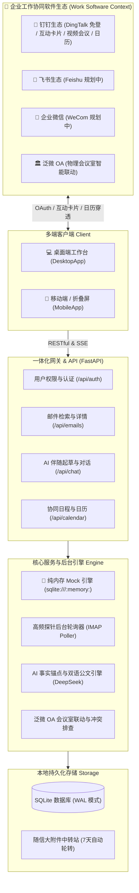

<div align="center">


# 知了 OnIt · AI 智能邮件协同工作台
### 重构工作场景的「企业协同原生」邮件中枢

<p>
  <b>工作的事情 · 交给工作的软件</b><br />
  不是又一个把邮箱挂在聊天框里的个人 Bot，而是把邮件深度重构进企业办公生态的原生工作流系统
</p>

<p>
  <b>深度融入工作环境</b> · 
  <b>邮件 ➔ 日程 ➔ 视频会议 ➔ OA 全贯通</b> · 
  <b>双语 1:1 镜像公文</b> · 
  <b>5 秒纯内存开箱体验</b>
</p>

<p align="center">
  <a href="https://github.com/Jolly-J/ai-email-assistant"></a>
  <a href="LICENSE"></a>
  
  
  
  
  
  
</p>

**让跨国商务沟通，如母语般自如得体；让邮件协同处理，如即时办公般顺畅自然。**  
不仅是智能收发信，更是一整套嵌入企业工作软件（钉钉、未来扩展至飞书/企微等）的协作闭环 —— 智能提炼商务要点、双语对称拟定公文、一键穿透联动排期与物理会议室，数据 100% 本地自托管。

[🚀 5 秒极速体验 (Mock模式)](#-5-秒极速体验--开箱即用-mock-模式) · [💡 为什么做这个项目？](#-为什么做这个项目--重新思考ai接管邮箱的真实痛点) · [⚖️ 核心差异化定位](#-核心差异化对比为什么不只是一个-ai-托管插件) · [✨ 核心功能亮点](#-核心功能亮点) · [🗺️ 协同生态演进规划](#-企业协同生态演进规划) · [🛠️ 真实企业部署](#-真实企业部署指引) · [🤝 欢迎共创](#-写在前面--欢迎共创)

</div>

---

## 💡 为什么做这个项目？—— 重新思考：AI“接管邮箱”的真实痛点

市面上能让 AI“接管邮箱”的工具很多：豆包、腾讯 WorkBuddy、ChatGPT 各种邮件插件、浏览器外挂助手……它们确实能连上 IMAP，帮你概括一封信或者吐出一段答复。

**但为什么在真实工作中，员工依然感到繁琐和割裂？**

因为市面上绝大多数工具，仅仅把邮件塞进了一个**孤立的个人聊天对话框**，根本没有触及现代企业协同的真实场景。在实际企业运作中，一封商务邮件从来都不是孤立的几行文字，它背后连接着一整套复杂的组织协同行动：

1. **邮件里敲定了下周开会** ➔ 员工需要建视频会议房间、核对参会人空闲时段、查企业物理会议室冲突、派发日历通知；
2. **客户发来突发交期预警** ➔ 需要第一时间同步到内部项目群、精准 @对应产线负责人、沉淀为团队待办；
3. **员工调岗或离职** ➔ 邮件往来涉及企业核心商务资产，不能散落在个人的第三方 AI 聊天账号中，必须有严密的组织身份治理与交接机制。

如果只是给邮箱挂上一个外挂 Bot，员工依然要在**“邮件客户端 ➔ 网页 AI 聊天框 ➔ 钉钉/飞书工作台 ➔ OA 审批系统 ➔ 各种视频软件”**之间来回复制粘贴、当“人肉数据搬运工”。这不仅谈不上提效，反而制造了新的信息孤岛。

### 我们的核心主张：工作的事情，就必须交给工作的软件

**知了 OnIt 的定位不是一个单纯的“AI 邮箱插件”，而是直接重构了邮件在企业环境中的工作场景：**

- **重构工作通知与感知节拍**：不再靠冷冰冰的邮件小红点，而是通过工作软件原生的富交互卡片流，把信件的中文摘要、关键待办与决策建议直接推送到日常工作流眼前；
- **重构业务执行工作环境**：信件商谈的诉求，原地转化为企业行动 —— 一键创建官方视频会议日程、模糊拉取同事、泛微 OA 会议室静默锁房；
- **重构组织资产与身份治理**：深度依托企业工作软件的免登身份（OAuth）、通讯录部门架构与分级授权，让邮件协作真正沉淀为企业自主可控的数字资产。

---

## ⚖️ 核心差异化对比：为什么不只是一个 AI 托管插件？

| 考量维度 | 独立 AI 邮箱助手（如豆包 / WorkBuddy / ChatGPT 插件） | 传统邮件客户端（如 Outlook / Foxmail） | **知了 OnIt（本项目）** |
| :--- | :--- | :--- | :--- |
| **产品定位** | 孤立对话框式外挂，局限于单兵“文字问答” | 纯静态邮件收发工具，无智能与组织基因 | **原生嵌入工作软件的协同中枢，全流程重构工作场景** |
| **工作环境** | 必须跳出到独立的网页、插件或第三方 App 窗口 | 封闭桌面客户端，与日常办公即时沟通完全割裂 | **深度融入企业工作软件（钉钉/未来扩展飞书与企微），无需反复切换视窗** |
| **协同闭环** | 无法感知企业内部日程、通讯录、权限与会议室 | 无法自动将商务磋商转化为企业具体组织行动 | **邮件意向 ➔ 官方视频会议 ➔ 内部日程直推 ➔ OA 物理会议室静默占位一体化** |
| **通知节拍** | 被动依赖系统弱提醒，极易淹没在弹窗海中 | 传统的邮件列表红点，无法直接在信外预览决断 | **工作软件原生互动卡片推送，工作流中即时查看核心要点与待办，极速决策** |
| **商务公文质感** | 易产生机械中译与通用套话，常有落款倒置隐患 | 纯靠员工人工手打，措辞耗时耗力且易失礼 | **双语 1:1 镜像对称公文对照、商务策略对照解析、严谨的定稿保护与防倒置红线** |
| **组织与数据治理**| 账号分散在员工个人 AI 平台，人员流动数据断档 | 需单独维护邮箱账号密码，人事交接成本高 | **绑定企业通讯录秒级免登，支持员工授权治理与组织架构平移，资产不流失** |
| **上手门槛** | 需配置外部模型 Key 或梯子 | 必须拥有真实外贸邮箱凭证 | **内置纯内存 Mock 模式，免配钉钉免邮箱，5 秒开箱体验全场景** |
| **数据安全** | 商业敏感信件上传至第三方公有云 | 数据托管在外部邮件服务商云端 | **100% 本地自托管，单文件 SQLite/WAL，商业敏感资产完全自主掌控** |

---

## 🚀 5 秒极速体验 · 开箱即用 (Mock 模式)

我们深知大家体验新工具的痛点：**不需要预先配置任何钉钉应用，不需要绑定任何真实邮箱，不用充值任何 AI Key，一条命令直接跑起来！**

```bash
# 1. 克隆本项目
git clone https://github.com/Jolly-J/ai-email-assistant.git
cd ai-email-assistant

# 2. 安装基础依赖（仅需标准 Node.js 与 Python 环境）
npm ci
npm --prefix frontend ci
python3 -m venv backend/.venv
backend/.venv/bin/python3 -m pip install -r backend/requirements.txt

# 3. 一键启动纯内存 Mock 模式
npm run dev:mock
```

启动完成后，打开浏览器访问 `http://127.0.0.1:4667`：
- 点击 **【一键体验（Mock 演示模式）】** 即可直接进入主工作台；
- **纯内存隔离运行**：采用 `sqlite:///:memory:`，零磁盘文件写入，完全不污染真实业务库，停机即自动销毁；
- **全场景预置数据**：收件箱、已发送、草稿箱预装了 10 封涵盖跨国采购大单询盘、供应链突发交期预警、技术接口联合评审等真实业务邮件；
- **离线秒返翻译**：预置高保真原位译文，点击【翻译】瞬时呈现，零等待且零 API Token 消耗。

---

## ✨ 核心功能亮点

### 1. 🏢 工作软件深度嵌入：把事情留在工作环境中
- **企业工作台原生集成**：首发深度集成钉钉企业应用体系，支持桌面端与移动端基于 OAuth 2.0 免密秒级登录，告别账号密码反复维护；
- **富交互卡片推送（通知节拍）**：后台检测到重要邮件时，自动向工作软件推送结构化互动卡片，员工在聊天流中一眼便知原信摘要、对方核心诉求与 AI 建议，点击直达对应邮件；
- **企业日程与视频会议一站式闭环**：
  - 自动识别信件中的会议约定意向；
  - 直通钉钉官方 OpenAPI，一键生成正式的视频会议房间并关联企业日程；
  - 模糊匹配添加部门内部参会同事，日程与提醒秒级推达全员移动端；
  - 针对外部客户自动签发标准 RFC 5545 格式的 `.ics` 国际日历附件；
- **物理会议室静默联动**：与企业内部泛微 OA 物理会议室联动，实时检测时段冲突并静默锁房。

### 2. 🤖 深度 AI 伴随起草与双语公文矩阵
- **事实锚点与发信人防倒置红线**：AI 牢固锁定原信业务事实与我方真实身份，绝不捏造承诺，绝不将客户姓名误作为落款署名；
- **双语 1:1 镜像对称公文**：同时输出纯正外语回复草稿（`draft_reply`）与 1:1 对称的中文公文对照（`draft_reply_zh`），并附带中文沟通策略说明（`explanation`）；
- **读信伴随与主动写信向导**：
  - 读信伴随（`AICopilot`）：随时口语化微调草稿（例如：“语气更委婉一点”、“推迟到周三”）；
  - 写信向导（`ComposeCopilot`）：内置外贸推介、商务合作、会议敲定、客情维系等 4 大高频场景向导。

### 3. 🌍 复杂长邮件高保真原位翻译
- **不破坏原排版**：采用原位 HTML 解耦翻译策略，完整保留原信的表格、字体、配色与视觉层次；
- **智能视口测绘与等比自适应**：自动探测邮件物理固有宽度，在 85%~98% 舒适阅读区间动态等比缩放，彻底消除横向滚动条假溢出；
- **双向瞬切**：支持一键秒切译文与原文，带本地缓存避免重复消耗。

### 4. 📱 多端全场景响应式体系（电脑 / 手机 / 折叠屏）
- **桌面端**：高效三栏联动，邮件列表平滑下推动效，支持抄送/密送（Cc/Bcc）展开收起与大附件本地中转站；
- **移动端（手机）**：专为触屏优化的单栏推栈阅读与专属写信抽屉；
- **折叠屏专属双栏**：毫秒级自动识别折叠屏内屏展开状态，维持 45%:55% 黄金阅读视觉比。

---

## 🗺️ 企业协同生态演进规划

知了 OnIt 的终极目标不是绑定单一工具，而是**将企业邮件重构进各大主流协同办公生态**：

- [x] **钉钉生态深度集成（当前已就绪）**：
  - 客户端免密登录与通讯录组织同步
  - 钉钉新邮件互动卡片与 Stream 回调
  - 钉钉官方视频会议日程一体化创建
  - 泛微 OA 会议室联动与冲突排查
- [ ] **飞书生态适配（规划中）**：
  - 飞书开放平台免登与组织架构对接
  - 飞书消息互动卡片直推
  - 飞书日历与飞书会议（Feishu Meetings）联动
  - 飞书多维表格（Bitable）待办同步
- [ ] **企业微信生态适配（规划中）**：
  - 企业微信工作台与扫码认证集成
  - 企微图文卡片与审批流打通
  - 微盘大附件中转集成
- [ ] **通用办公基础设施**：
  - 企业标准 LDAP / SAML 单点登录支持
  - Webhook 开放事件流接入

---

## 💬 平时怎么使？（真实业务对话示例）

进入工作台后，你可以像指着屏幕跟资深商务助理对话一样，用纯大白话向 AI 发送指令：

- 💬 **调整商务分寸**：“语气再委婉客气一点，表示原则上认可 30% TT 预付款，但需要通过我司信用保险审核。”
- 💬 **协调会议排期**：“告诉李工下周二下午我有外部客户接待，询问改在下周三下午 14:00 是否方便，并由我方提供视频会议链接。”
- 💬 **应对供应链危机**：“感谢德方供应商积极自费空运 200 套缓冲件的提议，确认接受，并提供我司上海口岸清关对接人。”
- 💬 **外贸询盘开发**：“帮我给欧洲新能源客户写一封推介信，重点介绍我们的 215kWh 液冷工商业储能一体柜与 CE/IEC 认证。”

---

## 🛠️ 真实企业部署指引

当你准备将系统接入企业实际环境时，只需补充配置相应的真实参数：

### 1. 环境依赖与配置文件
- **Python**：>= 3.10
- **Node.js**：>= 20.19.0 或 >= 22.12.0
- **数据库**：SQLite（默认单文件存储，自动启用 WAL 模式）

```bash
# 复制后端生产环境模版
cp backend/.env.example backend/.env
```

### 2. 核心配置项说明（`.env`）

| 配置项 | 说明 | 示例 / 默认值 |
| :--- | :--- | :--- |
| `COMPANY_NAME` | 内部企业中文名称（用于 AI 拟稿与落款） | `知了智能科技有限公司` |
| `COMPANY_NAME_EN` | 内部企业英文名称（用于外语商务邮件落款） | `Zhiliao Tech Co., Ltd.` |
| `COMPANY_DOMAIN` | 企业域名（用于生成日历 UID 与规范标识） | `example.com` |
| `SECRET_KEY` | JWT 鉴权密钥（新部署请生成专属密钥） | 由脚本自动生成随机 32 位安全密钥 |
| `ENCRYPTION_KEY` | 邮箱密码对称加密密钥（用于 AES 本地加密保护） | 由 Fernet 自动生成 32-urlsafe key |
| `DEEPSEEK_API_KEY` | DeepSeek API 密钥（用于 AI 深度分析与公文拟写） | `sk-...` |
| `DINGTALK_CLIENT_ID` | 钉钉企业内部应用 Client ID（AppKey） | 开源默认留空 |
| `DINGTALK_CLIENT_SECRET` | 钉钉企业应用 Client Secret（AppSecret） | 开源默认留空 |

> 🔑 **一键生成独立安全密钥**：  
> ```bash
> backend/.venv/bin/python3 - <<'PY'
> import secrets
> from cryptography.fernet import Fernet
> print('SECRET_KEY=' + secrets.token_urlsafe(32))
> print('ENCRYPTION_KEY=' + Fernet.generate_key().decode())
> PY
> ```

### 3. 正式启动与日常开发

```bash
# 一体化启动模式（自动管理前端热重载与后端服务，绑定 4667 端口）
npm run dev

# 数据库迁移升级（Knex 自动版本控制）
npm run migrate
```

> 📖 **服务器生产部署**：  
> 生产环境推荐使用宝塔面板或 Supervisor 托管后台单进程，搭配 Nginx 反向代理。详见 **[宝塔生产环境部署手册 (README_BAOTA.md)](README_BAOTA.md)**。

---

## 🏗️ 系统架构图



---

## 🤝 写在前面 & 欢迎共创！

本项目诞生于我们团队内部对“跨国邮件沟通效率与尊严”的真实痛点探索。经过多轮迭代与企业实测，我们将其完整脱敏开源。

我们非常欢迎社区开发者和外贸从业者一同参与完善：
- 💡 **提交需求或 Bug**：欢迎随时提交 [Issues](https://github.com/Jolly-J/ai-email-assistant/issues)；
- 🛠️ **贡献代码**：欢迎提交 Pull Request，为更多协同生态（如飞书、企业微信、Outlook 插件等）扩展适配；
- 🌟 **如果这个项目对你的跨国沟通有所启发或帮助，欢迎点亮右上角的 Star 给予支持！**

---

## 📄 开源许可证

本项目采用 **[MIT License](LICENSE)** 开源许可证。
