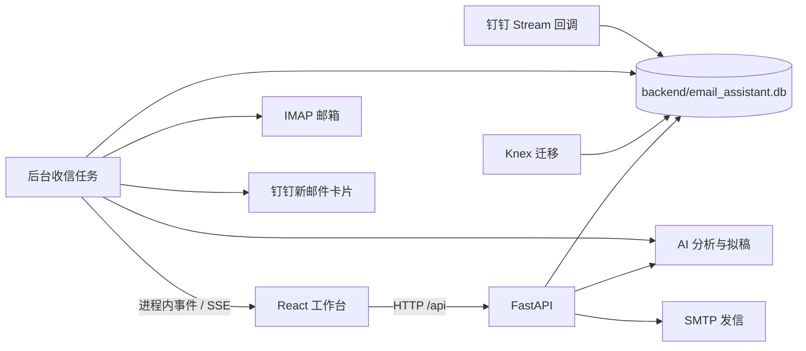

# 知了 · AI 企业邮件工作台

面向企业员工的邮件工作台：通过钉钉登录和管理员授权，绑定个人工作邮箱，集中查看邮件，生成中文摘要与回复草稿，并在用户确认后通过原邮箱发信。

本文依据当前仓库实现整理。AI 接手先读 [AGENTS.md](AGENTS.md)；前端开发见 [frontend/README.md](frontend/README.md)；服务器部署见 [README_BAOTA.md](README_BAOTA.md)；本地数据库盘点与清理记录见 [DATABASE_AUDIT.md](DATABASE_AUDIT.md)；AI 提示词与上下文工程规范见 [PROMPT_ENGINEERING.md](PROMPT_ENGINEERING.md)。

## 当前功能

- 钉钉客户端免登、浏览器扫码登录、组织通讯录同步、员工使用权限及管理员权限管理。
- 多邮箱绑定、IMAP/SMTP 连通性测试、邮箱别名与手动同步。
- 收件箱、已发送、草稿箱、垃圾箱，以及已回复/已归档视图；账号、已读状态、关键词筛选与历史邮件拉取。
- 邮件 HTML/纯文本阅读、宽度适配与缩放、中文翻译。
- AI 中文摘要、核心要点、对方诉求、应对建议；按员工指令进行多轮拟稿，提供外语正文、完整中文对照和策略说明。
- 新邮件主动写信、原信回复，桌面与移动端支持收件人/抄送/密送；发送后保存本地发件箱记录并追加远端 IMAP。
- 后台收信及 SSE 列表更新；符合条件的新收件箱邮件投放钉钉卡片，点击“查看邮件”定位到工作台。

这里的草稿箱是 IMAP 文件夹，AI 回复草稿存于对话记录中，两者不同。当前没有可用的普通账号注册/密码登录路由；以钉钉登录为入口。

## 架构与目录

前端为 React 19 + TypeScript 6 + Vite 8 + Tailwind CSS 3.4；后端为 FastAPI + SQLAlchemy，使用 SQLite/WAL。Knex 负责版本迁移，后端启动还有历史补列逻辑。邮件连接使用 Python IMAP/SMTP，AI 使用配置的 DeepSeek 兼容 Chat Completions 地址。



```text
.
├── AGENTS.md                 AI 协作规则与定位入口
├── README.md                 使用、开发与维护总入口
├── README_BAOTA.md           宝塔/Supervisor 部署
├── DATABASE_AUDIT.md         数据库审查与清理记录
├── PROMPT_ENGINEERING.md     AI 上下文与 Prompt 工程规范
├── package.json              一体化开发、构建、Knex 命令
├── knexfile.js               固定连接 backend/email_assistant.db
├── migrations/              四份版本迁移（含新增密送字段）
├── scripts/dev.js           一体化开发进程管理
├── backend/
│   ├── main.py               API、启动迁移/补列、轮询、Stream、静态托管
│   ├── requirements.txt      Python 依赖
│   ├── .env.example          后端环境示例（需补全配置）
│   ├── app/api/              认证、邮箱、邮件、AI 对话、钉钉/管理
│   ├── app/core/             配置、会话、安全、时间、语言初判、日志、限流
│   ├── app/models/           用户、邮箱、邮件、对话四个模型
│   ├── app/services/         IMAP/SMTP、AI、钉钉、轮询、SSE
│   └── test_*.py             需逐项审查和隔离的测试脚本
├── frontend/
│   ├── src/App.tsx           页面状态和主要业务编排
│   ├── src/components/       业务界面及共享 ui 组件
│   ├── src/lib/              API 契约与通用函数
│   ├── src/assets/           import 型资源
│   ├── public/               扫码脚本、品牌与服务商图标
│   └── dist/                 构建产物，由后端托管（Git 忽略）
├── 品牌资源/                 设计源稿及导出图
└── logs/                     运行日志（Git 忽略）
```

源码、脚本及资源目录都有本地 `AGENTS.md`。数据库、`.env`、依赖、日志与构建产物不提交到 Git。

## 新环境准备

需要 Python 3.10 或以上，以及满足当前依赖要求的 Node.js/npm。当前 Vite 的 Node 要求是 `^20.19.0 || >=22.12.0`，根 sqlite3 包要求 `>=20.17.0`。下面的命令用于 macOS/Linux；Windows 虚拟环境可执行文件位于 `.venv/Scripts/`。

在项目根目录安装依赖：

```bash
npm ci
npm --prefix frontend ci
python3 -m venv backend/.venv
backend/.venv/bin/python3 -m pip install -r backend/requirements.txt
```

已有部署直接使用现有虚拟环境和配置，不覆盖已有 `.env` 或密钥。Python 依赖文件使用版本下限，尚无完整锁定文件；升级时记录实际安装版本并验证。

### 后端配置

首次安装且尚无配置文件时，在根目录执行：

```bash
test -e backend/.env || cp backend/.env.example backend/.env
```

按下表补齐 `backend/.env`。示例文件不包含所有钉钉/卡片变量，以 [config.py](backend/app/core/config.py) 与本表共同核对；代码中的历史默认凭据不用于新环境。

| 变量 | 配置说明 |
| --- | --- |
| `DATABASE_URL` | 标准值 `sqlite:///./email_assistant.db`；要求后端 cwd 为 `backend/` |
| `SECRET_KEY` | 自行生成的 JWT 签名密钥；更换后旧 token 失效 |
| `ENCRYPTION_KEY` | 自行生成的 Fernet key；已有库必须沿用原 key，否则邮箱授权码不能解密 |
| `DEEPSEEK_API_KEY` | AI key；留空会使用降级内容 |
| `DEEPSEEK_BASE_URL` | 默认 `https://api.deepseek.com`，代码会追加 `/chat/completions` |
| `DEEPSEEK_MODEL` | 默认 `deepseek-chat`；需与实际接口的模型及请求参数兼容 |
| `POLL_INTERVAL_SECONDS` | 默认 10；每轮任务完成后等待的秒数，实际收信间隔还包含处理耗时 |
| `DINGTALK_CLIENT_ID` | 本企业应用的 client ID / AppKey |
| `DINGTALK_CLIENT_SECRET` | 对应应用 secret，只放后端 |
| `DINGTALK_CORP_ID` | 企业 corp ID |
| `DINGTALK_ADMIN_USERIDS` | 管理员钉钉 userId，英文逗号分隔 |
| `DINGTALK_CARD_TEMPLATE_ID` | 与代码变量匹配的卡片模板 ID；留空跳过新卡片投放 |
| `DINGTALK_ROBOT_CODE` | 卡片投放 robot code；为空时回退 client ID |
| `APP_BASE_URL` | 员工可访问的工作台地址，用于卡片 AppLink；本地默认 `http://127.0.0.1:4667` |
| `DINGTALK_AGENT_ID` | 已声明的兼容配置，当前主要投放逻辑使用 robot code |

`PROJECT_NAME` 可覆盖服务名。`API_V1_STR` 虽可配置，但前端基址及健康路径仍写定 `/api`，不要只修改这一项。

新环境可以使用下面的命令生成两项独立密钥，再手工写入对应配置；已有环境不要据此替换原加密密钥：

```bash
backend/.venv/bin/python3 - <<'PY'
import secrets
from cryptography.fernet import Fernet
print('SECRET_KEY=' + secrets.token_urlsafe(48))
print('ENCRYPTION_KEY=' + Fernet.generate_key().decode())
PY
```

后端 Settings 从 cwd 的 `.env` 读取，进程环境中的同名变量可覆盖它。`LOG_DIR` 另由日志模块直接读取进程环境，需要在启动器/Supervisor 中设置，不能只依赖 `.env` 中同名键。

### 前端公开配置

可在 `frontend/.env` 设置：

```dotenv
VITE_DINGTALK_CLIENT_ID=填写本企业应用的公开客户端ID
VITE_DINGTALK_CORP_ID=填写本企业公开corpId
```

登录组件优先请求后端公开配置，这两项用于回退。`VITE_*` 会进入浏览器产物，不得填写 secret 或 AI key。修改后重新构建或重启 Vite。

## 启动方式

### 一体化开发启动：4667

在根目录运行：

```bash
# 标准模式（按 .env 配置运行，未配置钉钉时会自动就绪演示体验）
npm run dev

# 强制 Mock 演示体验模式（免钉钉配置，内置 3 封真实场景演示邮件，一键体验全量功能）
npm run dev:mock
```

访问 [本地工作台](http://127.0.0.1:4667)。
- 使用 `npm run dev:mock` 启动时，直接激活 Mock 演示模式。登录页提供**“一键进入演示工作台”**，系统会自动创建演示管理员并注入 3 封典型中英文模拟邮件，方便快速体验 AI 摘要、多轮回复起草和会议排期。
- 使用 `npm run dev` 启动时，按 `.env` 连接企业钉钉开放平台与邮箱服务；若尚未配置钉钉参数，系统同样会自动提供 Mock 体验通道。脚本会强制释放 4667/4666、运行迁移、准备前端构建并启动后端。

### 前后端分开开发：4666 + 4667

先在根目录完成迁移与构建准备：

```bash
npm run migrate
npm run build
```

终端一切换到 backend：

```bash
cd backend
.venv/bin/python3 -m uvicorn main:app --host 127.0.0.1 --port 4667 --reload
```

终端二从项目根目录运行：

```bash
npm --prefix frontend run dev
```

访问 [Vite 开发页面](http://127.0.0.1:4666)，其 `/api` 代理到 4667。`npm --prefix frontend run preview` 仅用于构建产物预览，当前没有相应 API 代理。

### 生产运行

先安装根 Node 依赖、构建前端、执行迁移，再从 backend 启动不带 reload 的单 worker Uvicorn。当前后端启动仍调用 `npx knex`，服务器需要 Node/npm 及根目录依赖；已有 dist 仅省去前端现场编译需求。详细步骤见[宝塔部署指南](README_BAOTA.md)。

事件总线、限流和 token 缓存位于进程内，每个应用进程都会启动轮询与 Stream。当前不要直接增加 workers。

## 首次使用与业务流程

1. 配置本企业钉钉应用、回调地址和管理员清单，使用对应身份登录。当前代码在库中没有管理员时，会让首位成功核验的登录者成为管理员，初始化应由指定人员完成。
2. 管理员同步组织，并给需要使用的员工开通权限。同步进来的其他员工默认待授权；未开通不代表无效档案。
3. 员工绑定邮箱，使用服务商允许的 IMAP/SMTP 客户端密码或授权码。后台先测试连通性，通过后加密保存并安排首次同步。
4. 在工作台查看邮件和 AI 建议，输入回复意图生成草稿，核对外文正文、中文对照和收件人后确认发送。
5. 首次/手动同步不发新邮件卡片。后台轮询发现已有 UID 基线的收件箱新记录时，才尝试向对应员工投放“查看邮件”卡片。

服务商预设以 `mail_service.py` 的 `PROVIDER_PRESETS` 为准；当前包含阿里企业/个人、QQ、腾讯企业、网易 163/126 和自定义配置。

## 数据库与维护

标准业务库只有 `backend/email_assistant.db`。四张业务表是 `users`、`mail_accounts`、`email_records`、`chat_messages`；Knex 的两张管理表及 SQLite 的自增管理表也需保留。

- Knex 固定指向 backend 下的库，Python 使用 `DATABASE_URL`。改变后端 cwd 或只改其中一个连接目标，会造成“迁移一个库、应用访问另一个库”。
- `main.py` 还补齐四个对话/卡片字段；只运行 Knex 不代表全部当前字段已就绪。
- 运行中的 `-wal`、`-shm` 与主库一起保护。活动数据库备份使用 SQLite backup API 等一致性方式；简单复制主 `.db` 可能漏掉 WAL 内已提交数据。
- 停机备份/恢复时同时保存原 `ENCRYPTION_KEY` 的安全副本。恢复后先核对目标路径、表结构、关联数据和凭据解密，再恢复收发服务。
- 2026-09-05 已按用户授权清理三个无用空库，详见[审查记录](DATABASE_AUDIT.md)。以后不能因文件小、未跟踪或表暂时为空就直接删除。

## 验证与排错

| 检查 | 命令或入口 | 能说明什么 |
| --- | --- | --- |
| 前端 lint | 根目录 `npm --prefix frontend run lint` | 当前 Oxlint 规则检查 |
| 前端构建 | 根目录 `npm run build` | TypeScript 与 Vite 构建结果，会写 dist |
| 服务健康 | [健康接口](http://127.0.0.1:4667/api/health) | FastAPI 能响应，不验证数据库或外部服务 |
| API 定义 | [OpenAPI](http://127.0.0.1:4667/api/openapi.json)、[接口文档](http://127.0.0.1:4667/docs) | 当前运行实例公开的路由/模型 |
| 后端测试 | [测试逐项说明](backend/AGENTS.md) | 先隔离库与外部服务，再选择适用脚本 |
| 静态路径与附件路由回归 | 根目录 `backend/.venv/bin/python3 backend/test_spa_paths.py` | 使用临时文件验证路径穿越防护、SPA 回退及附件 GET/HEAD/Range；不启动应用或操作业务库 |

运行日志默认在 `logs/app.log` 和 `logs/error.log`，分别按天轮转保留 14 天、30 天；后者包含 WARNING 及以上。查看日志仍需避免传播凭据、员工资料和邮件内容。

排错先保留原始状态码、脱敏错误字段、触发步骤与实际 cwd。迁移输出失败后应用仍可能继续启动；端口启动横幅、健康接口或 AI 降级响应都不能代替业务成功证据。

## 已知实现边界

- 普通登录/注册的前端旧方法与旧集成脚本仍保留，后端当前未实现对应路由。
- 新写信弹窗的 AI 润色调用 `/chat/0`，后端仍要求真实邮件 ID，没有通用拟稿分支。
- 新卡片只有查看入口；Stream 的拟稿/发送分支属于保留实现，未据此声称当前卡片模板已开放操作。
- Stream 会发送 `email_replied`，但 App 当前未消费该事件；网页回复也未发现调用卡片状态更新方法。跨端状态不应描述为完整闭环。
- 翻译当前面向简体中文；复杂 HTML 采用文本翻译与重新排版，不保证保持原信布局。
- `frontend/dist/` 不自动清空，旧构建文件会保留；部署前需核对 index 实际引用的产物。

这些是接手时需要核对的现状，不是本次文档工作已修复或已完成真实客户端验收的声明。

## 抄送与密送升级

新邮件和普通回复都可展开“添加抄送 / 添加密送”，支持中英文逗号、分号分隔多个邮箱。普通回复不自动继承原信名单，本次不包含“回复全部”。重复地址按收件人、抄送、密送顺序保留首次出现的位置。输入支持普通邮箱及简单显示名，不支持 SMTPUTF8 国际化邮箱或带引号的特殊 local-part。

SMTP 投递名单包含三类地址，对外邮件不含 Bcc 头。本地已发送记录和 IMAP 私有发件箱副本保留密送名单；详情仅向属主返回已发送邮件的密送字段。重新拉取远端已发送邮件时，仅保存服务商实际提供的 Bcc，不猜测或批量回填旧数据。

部分拒收时界面持续显示拒收地址及“请勿整封重复发送”，已接受的邮件仍保存发送记录。收件名单表示邮件填写内容，不是逐人送达回执；本次未引入逐人投递状态表。SMTP 接受也不等于最终送达。

发布前核对 Python 与 Knex 指向同一业务库，使用 SQLite 一致性备份（不能只复制活动 `.db`），然后在项目根执行 `npm run migrate`，确认成功后再启用新后端。新增 `20260918000001_add_bcc_recipients.js` 仅增加 `bcc_recipients TEXT DEFAULT ''`，抄送复用旧列；不删表、重建表或改写旧邮件。缺表或同名列类型异常时停止，禁止删库重试、清空迁移记录或通配符清理 WAL/SHM。新迁移拒绝回滚，保留数据与迁移记录。现有启动流程不会可靠地阻止迁移失败后的启动，必须单独确认迁移结果。

以下代码检查不启动业务服务：

```bash
PYTHONDONTWRITEBYTECODE=1 backend/.venv/bin/python3 backend/test_mail_recipients.py
node scripts/test_mail_recipients.mjs
node scripts/test_bcc_migration.mjs
```

Python 测试采用内存 SQLite 和模拟 SMTP/IMAP；迁移测试只在独立临时目录创建合成数据库，不读取主库或根 Knex 配置。界面及真实邮箱收发另行验收。
