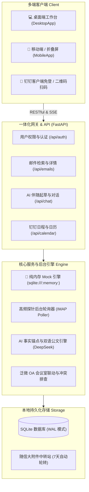

<div align="center">


# 知了 OnIt · AI 智能邮件协同工作台
### 专为跨国商务与外贸团队打造的「邮件智能协同中枢」

<p>
  <b>听得懂商业诉求</b> · 
  <b>拟得出地道公文</b> · 
  <b>一键排期协同敲定</b> · 
  <b>5秒纯内存开箱体验</b>
</p>

<p align="center">
  <a href="https://github.com/Jolly-J/ai-email-assistant"></a>
  <a href="LICENSE"></a>
  
  
  
  
  
  
</p>

**让跨国商务沟通，如母语般自如得体。**  
不仅是邮件收发，更是深度融入企业办公生态的 AI 伴随助理 —— 自动提炼外语商务要点、1:1 生成地道中英文公文、自动联动钉钉排期与会议室，数据 100% 本地自托管。

[🚀 5 秒极速体验 (Mock模式)](#-5-秒极速体验--开箱即用-mock-模式) · [💡 为什么做这个项目？](#-为什么做这个项目) · [✨ 核心功能亮点](#-核心功能亮点) · [🛠️ 真实企业部署](#-真实企业部署指引) · [🤝 欢迎共创](#-写在前面--欢迎共创)

</div>

---

## 💡 为什么做这个项目？

平时负责海外业务或企业跨国沟通的朋友，可能经常面临这几重让人抓狂的困扰：

1. **机翻生硬，容易失礼**：直接把复杂的商业信函扔给通用翻译软件，往往词不达意，丢失了商业博弈中的语气分寸与潜台词；而员工自己动手拟写外文回信时，又总担心语法生硬、公文措辞欠妥、甚至发信人与落款倒置；
2. **邮件与办公协同严重割裂**：客户在邮件里提议“下周二 15:00 安排一次视频沟通”，员工往往要在邮件客户端、钉钉日历、视频会议、OA 会议室系统之间来回横跳，繁琐低效；
3. **开源项目“上手门槛奇高”**：市面上大部分邮件工作台，一上来就强制要求配齐钉钉开放平台凭证、管理员权限和真实外贸邮箱；没等你配好第一项，就被各种报错劝退了。

### 核心差异化对比：拒绝割裂与繁琐

| 考量维度 | 传统邮件客户端（如 Outlook / Foxmail） | 通用网页大模型（如 ChatGPT / Claude） | **知了 OnIt（本项目）** |
| :--- | :--- | :--- | :--- |
| **邮件理解** | 纯静态收发，长邮件全靠人工肉眼通读 | 需反复手动复制粘贴，缺乏邮件上下文 | **自动提炼中文摘要、核心要点、对方诉求与引导追问** |
| **商务拟稿** | 无辅助，手写外语邮件费时费力 | 易出现通用套话或发件人落款倒置 | **双语 1:1 镜像对称公文对照、商务策略解析与定稿保护** |
| **会议排期** | 孤岛式客户端，无法联动企业办公流 | 无法感知企业内部日程与物理会议室 | **邮件会议意向自动识别、钉钉视频日程直达、泛微 OA 会议室联动** |
| **阅读体验** | 长邮件或复杂 HTML 容易排版错乱 | 只能粘贴纯文本，格式丢失殆尽 | **沙箱隔离渲染、视口等比智能适配（85%~98%）、高保真原位翻译** |
| **体验门槛** | 必须有真实企业邮箱账号密码 | 需科学上网或充值海外 API Key | **内置纯内存 Mock 模式，免配钉钉免邮箱，5 秒开箱体验全场景** |
| **数据安全** | 邮件数据托管在第三方云厂商 | 商业敏感信息直接传给公有云 | **100% 私有化自托管，单文件 SQLite/WAL，数据资产完全自主掌控** |

---

## 🚀 5 秒极速体验 · 开箱即用 (Mock 模式)

我们深知大家的体验痛点：**不需要配置任何钉钉应用，不需要绑定任何真实邮箱，不用充值任何 AI Key，一条命令直接跑起来！**

```bash
# 1. 克隆本项目
git clone https://github.com/Jolly-J/ai-email-assistant.git
cd ai-email-assistant

# 2. 安装基础依赖（仅需标准 Node.js 与 Python 环境）
npm ci
npm --prefix frontend ci
python3 -m venv backend/.venv
backend/.venv/bin/python3 -m pip install -r backend/requirements.txt

# 3. 一键启动纯内存 Mock 模式
npm run dev:mock
```

启动完成后，打开浏览器访问 `http://127.0.0.1:4667`：
- 点击 **【一键体验（Mock 演示模式）】** 即可直接进入主工作台；
- **纯内存隔离运行**：采用 `sqlite:///:memory:`，零磁盘文件写入，完全不污染真实业务库，停机即销毁；
- **全场景预置数据**：收件箱、已发送、草稿箱预装了 10 封涵盖跨国采购大单询盘、供应链突发交期预警、技术接口联合评审等真实业务邮件；
- **离线秒返翻译**：预置高保真原位译文，点击【翻译】瞬时呈现，零等待且零 API Token 消耗。

---

## ✨ 核心功能亮点

### 1. 🤖 深度 AI 伴随起草与双语公文矩阵
- **事实锚点与发信人防倒置红线**：AI 牢固锁定原信业务事实与我方真实身份，绝不捏造承诺，绝不将客户姓名误作为落款署名；
- **双语 1:1 镜像对称公文**：同时输出纯正外语回复草稿（`draft_reply`）与 1:1 对称的中文公文对照（`draft_reply_zh`），并附带中文沟通策略说明（`explanation`）；
- **读信伴随与主动写信向导**：
  - 读信伴随（`AICopilot`）：随时口语化微调草稿（例如：“语气更委婉一点”、“推迟到周三”）；
  - 写信向导（`ComposeCopilot`）：内置外贸推介、商务合作、会议敲定、客情维系等 4 大高频场景向导。

### 2. 🌍 复杂长邮件高保真原位翻译
- **不破坏原排版**：采用原位 HTML 解耦翻译策略，完整保留原信的表格、字体、配色与视觉层次；
- **智能视口测绘与等比自适应**：自动探测邮件物理固有宽度，在 85%~98% 舒适阅读区间动态等比缩放，彻底消除横向滚动条假溢出；
- **双向瞬切**：支持一键秒切译文与原文，带本地缓存避免重复消耗。

### 3. 📅 智能会议意图感知与钉钉企业生态联动
- **邮件会议意图自动感知**：AI 自动解析信件中的开会提议、议程与时间意向；
- **钉钉视频会议日程一键创建**：直通钉钉官方 OpenAPI，自动创建 DingTalk 视频会议房间，并模糊检索添加内部同事，日程直推全员手机端；
- **泛微 OA 物理会议室静默占位**：支持与企业内部泛微 OA 会议室字典联动，检测时段冲突并静默锁房；
- **外部客户日历邀请（.ics）**：自动签发标准 RFC 5545 格式的 `.ics` 日历附件，外部客户在 Outlook、iPhone 日历中一键导入。

### 4. 📱 多端全场景响应式体系（电脑 / 手机 / 折叠屏）
- **桌面端**：高效三栏联动，邮件列表平滑下推动效，支持抄送/密送（Cc/Bcc）展开收起与大附件本地中转站；
- **移动端（手机）**：专为触屏优化的单栏推栈阅读与专属写信抽屉；
- **折叠屏专属双栏**：毫秒级自动识别折叠屏内屏展开状态，维持 45%:55% 黄金阅读视觉比。

---

## 💬 平时怎么使？（真实业务对话示例）

进入工作台后，你可以像指着屏幕跟资深商务助理对话一样，用纯大白话向 AI 发送指令：

- 💬 **调整商务分寸**：“语气再委婉客气一点，表示原则上认可 30% TT 预付款，但需要通过我司信用保险审核。”
- 💬 **协调会议排期**：“告诉李工下周二下午我有外部客户接待，询问改在下周三下午 14:00 是否方便，并由我方提供视频会议链接。”
- 💬 **应对供应链危机**：“感谢德方供应商积极自费空运 200 套缓冲件的提议，确认接受，并提供我司上海口岸清关对接人。”
- 💬 **外贸询盘开发**：“帮我给欧洲新能源客户写一封推介信，重点介绍我们的 215kWh 液冷工商业储能一体柜与 CE/IEC 认证。”

---

## 🛠️ 真实企业部署指引

当你准备将系统接入企业实际环境时，只需补充配置相应的真实参数：

### 1. 环境依赖与配置文件
- **Python**：>= 3.10
- **Node.js**：>= 20.19.0 或 >= 22.12.0
- **数据库**：SQLite（默认单文件存储，自动启用 WAL 模式）

```bash
# 复制后端生产环境模版
cp backend/.env.example backend/.env
```

### 2. 核心配置项说明（`.env`）

| 配置项 | 说明 | 示例 / 默认值 |
| :--- | :--- | :--- |
| `COMPANY_NAME` | 内部企业中文名称（用于 AI 拟稿与落款） | `知了智能科技有限公司` |
| `COMPANY_NAME_EN` | 内部企业英文名称（用于外语商务邮件落款） | `Zhiliao Tech Co., Ltd.` |
| `COMPANY_DOMAIN` | 企业域名（用于生成日历 UID 与规范标识） | `example.com` |
| `SECRET_KEY` | JWT 鉴权密钥（新部署请生成专属密钥） | 由脚本自动生成随机 32 位安全密钥 |
| `ENCRYPTION_KEY` | 邮箱密码对称加密密钥（用于 AES 本地加密保护） | 由 Fernet 自动生成 32-urlsafe key |
| `DEEPSEEK_API_KEY` | DeepSeek API 密钥（用于 AI 深度分析与公文拟写） | `sk-...` |
| `DINGTALK_CLIENT_ID` | 钉钉企业内部应用 Client ID（AppKey） | 开源默认留空 |
| `DINGTALK_CLIENT_SECRET` | 钉钉企业应用 Client Secret（AppSecret） | 开源默认留空 |

> 🔑 **一键生成独立安全密钥**：  
> ```bash
> backend/.venv/bin/python3 - <<'PY'
> import secrets
> from cryptography.fernet import Fernet
> print('SECRET_KEY=' + secrets.token_urlsafe(32))
> print('ENCRYPTION_KEY=' + Fernet.generate_key().decode())
> PY
> ```

### 3. 正式启动与日常开发

```bash
# 一体化启动模式（自动管理前端热重载与后端服务，绑定 4667 端口）
npm run dev

# 数据库迁移升级（Knex 自动版本控制）
npm run migrate
```

> 📖 **服务器生产部署**：  
> 生产环境推荐使用宝塔面板或 Supervisor 托管后台单进程，搭配 Nginx 反向代理。详见 **[宝塔生产环境部署手册 (README_BAOTA.md)](README_BAOTA.md)**。

---

## 🏗️ 系统架构图



---

## 🤝 写在前面 & 欢迎共创！

本项目诞生于我们团队内部对“跨国邮件沟通效率与尊严”的真实痛点探索。经过多轮迭代与企业实测，我们将其完整脱敏开源。

我们非常欢迎社区开发者和外贸从业者一同参与完善：
- 💡 **提交需求或 Bug**：欢迎随时提交 [Issues](https://github.com/Jolly-J/ai-email-assistant/issues)；
- 🛠️ **贡献代码**：欢迎提交 Pull Request，为更多协同生态（如企微、飞书、Outlook 插件）扩展适配；
- 🌟 **如果这个项目对你的跨国沟通有所启发或帮助，欢迎点亮右上角的 Star 给予支持！**

---

## 📄 开源许可证

本项目采用 **[MIT License](LICENSE)** 开源许可证。
